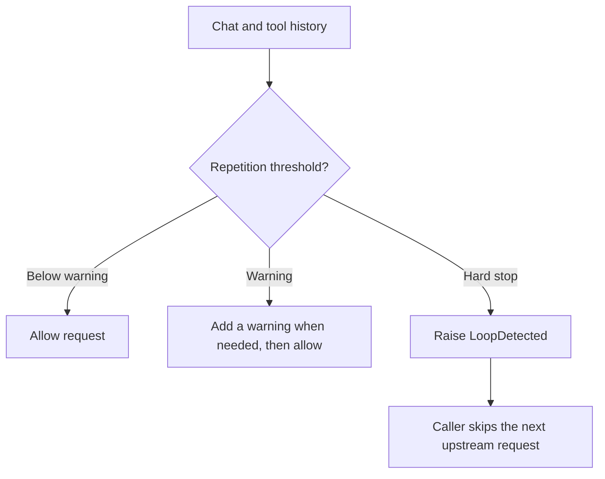

# Proxy Loop Guard

[English](README.md) · [繁體中文](README.zh-TW.md)

**Catch an LLM agent repeating itself before paying for the next model call.**

[MIT license](LICENSE)

Proxy Loop Guard is a small Python library extracted from a working LLM proxy.
It inspects existing chat/tool history, adds a warning when an agent appears
stuck, and raises an exception if repetition reaches a hard threshold.

No extra model calls. No runtime dependencies. No telemetry or network access.
There is **no measured token-saving percentage** for this standalone release.

This is a library for proxy and agent developers, not a Claude Code plugin or a
complete proxy server. It accepts OpenAI-style chat messages with tool calls.
Normalize other message formats before using it.

## Overview



A hard stop only prevents the next model request if your caller handles the exception; it does not cancel a running tool.

## Try it in a minute

Python 3.10 or newer:

```sh
git clone https://github.com/u6vu06Ou/proxy-loop-guard.git
cd proxy-loop-guard
python -m pip install .
python -m examples.demo
```

The offline demo allows calls 1–3, warns on calls 4–5, and blocks call 6.
It deliberately keeps repeating the same `Read` call to demonstrate escalation.
The cross-request stagnation rule fires before the same-signature limit of 12.
It never contacts a model. The project is not published on PyPI.

## Add it to a proxy

Create the guard once, outside your request handler. Pass the complete tool
history before each upstream model request, including tool results when present:

```python
from proxy_loop_guard import LoopDetected, LoopGuard

guard = LoopGuard()

def handle_model_request(request, conversation_id, call_upstream):
    try:
        guard.check(request, session_id=conversation_id)
    except LoopDetected as error:
        # Your framework should return this error without calling upstream.
        return {"error": error.detail, "status": error.status_code}
    return call_upstream(request)
```

`check` returns the same request object. It can append one `role: "user"`
warning message in place. A hard stop raises `LoopDetected`, which carries
`status_code=400` and `detail`; translate these into your framework's actual
HTTP response. Returning an error dictionary alone does not set an HTTP status.

Use a stable, unique `session_id` on **every** request. State is keyed by session
ID, model name, and the first non-empty user message (up to 1,200 characters).
Keep that first task message stable. The internal `_session_hint` field is
removed before return, including when a hard stop raises.

For an async proxy, the check is synchronous and in-memory; await your upstream
client only after it succeeds. Streaming output is unaffected: this guard runs
before a request, not while a model is streaming.

## What it catches

| Signal | Warning | Block | Matching rule |
| --- | ---: | ---: | --- |
| Same tool and arguments | 5 calls | 12 calls | Canonical JSON arguments; includes unknown tool names |
| Changed arguments, same/empty result | 5 calls | 12 calls | Tool + target scope + normalized result |
| Repeated web fetch/search | 3 calls | 9 calls | Recognized web tool name + same URL/query |
| Repeated Grep | 5 calls | 15 calls | Same path and pattern |
| Failing Bash command | 5 calls | 12 calls | Same command, parsed nonzero exit code, and output |
| Successful Bash command | 25 calls | 50 calls | Same command with a parsed zero exit code |
| No new tool signatures across growing histories | 3 evaluations | 5 evaluations | Stateful stagnation detection |

Several rules can match the same history. The earliest applicable rule wins:
for example, identical Grep arguments normally hit the generic block at 12,
before the Grep-specific threshold of 15. A Bash exit code must appear in its
tool output as `Exit code: N`, `exit code N`, or `exited with code N`. Bash calls
without a parsed exit code are excluded from the call-count detectors.

The detector evaluates the most recent 160 tool calls. Repeats separated by
enough other calls start a new streak. Warning deduplication suppresses another
injection when the selected signal's count has not grown.

## Avoiding false alarms

- Different Grep patterns on one file count separately in the Grep rule.
- Changed `Edit`/`Write` calls and plan updates may return identical success
  confirmations; those results are exempt from the zero-progress rule. Exactly
  repeated arguments still count in the generic rule.
- Long-running work is not blocked merely for being old.
- Separate sessions and separate guard instances have separate state.

Known names include `Grep`, `Bash`, `WebFetch`, `WebSearch`, `web_fetch`, and
`web_search`. Progress-tool exemptions include `Write`, `Edit`, `MultiEdit`,
`NotebookEdit`, their listed lowercase aliases, `update_plan`, `TodoWrite`,
`TaskCreate`, `TaskUpdate`, and `TaskList`. Other tool names still receive generic
signature and result checks; their framework-specific semantics are not inferred.

## Configuration and diagnostics

```python
guard = LoopGuard({"generic_warn": 6, "generic_kill": 16})
diagnostics = guard.snapshot()  # Detached copy of latest events and counters.
guard.reset()                  # Forget all in-memory session state.
```

All thresholds are listed in `proxy_loop_guard.DEFAULT_CONFIG`. Overrides are
validated for known keys, positive integers, warning/block order, and whether
the history window can accommodate the call-based block thresholds. Raising
one threshold does not disable overlapping detectors.

The public API serializes checks with a lock. Multiple processes do not share
state: route a conversation to one worker if you need stagnation tracking and
warning deduplication across requests. Call-history rules still inspect the
history each worker receives. Idle sessions older than six hours are removed
when the registry exceeds 50 entries; this is cleanup, **not a hard memory cap**.

The library creates no log files. It uses the standard `proxy_loop_guard` logger;
you can also supply your own logger. Application logging configuration may emit
warnings and blocks. Diagnostic targets and logs can include commands, URLs,
file paths, and result previews; keep them out of public debug endpoints.

## Limits

This is a heuristic circuit breaker, not proof that an agent is making progress.
Legitimate polling or repeated reads can hit a threshold. Changed outputs and
new signatures can evade it. Stagnation depends on growth within the retained
window; it is not a reliable catch-all once that window is full, and progress
tools anywhere in that window suppress the stagnation signal.

A block prevents the **next** upstream model call if the caller handles the
exception. It does not terminate a session process, cancel a running tool, or
undo side effects. It needs complete, well-formed chat/tool history; it cannot
detect loops hidden inside one tool invocation. No model quality or cost claims
are implied by the included tests.

## Tests

```sh
python -m unittest discover -s tests -v
```

Tests cover warning/block boundaries, request cleanup, changed-query empty
results, progress-tool exemptions, session isolation, concurrency, configuration,
and the extracted detector's regression scenarios. All tests run offline.
GitHub Actions runs them on Linux and Windows with Python 3.10, 3.12 and 3.13.

## Origin

The detector originated in the author's private LLM proxy. This repository is a
fresh, standalone extraction with instance-scoped state, a framework-neutral
exception, English warning text, and no proxy routing, credentials, conversation
logs, or private Git history. It has no dependency on TokenEconomizer.
