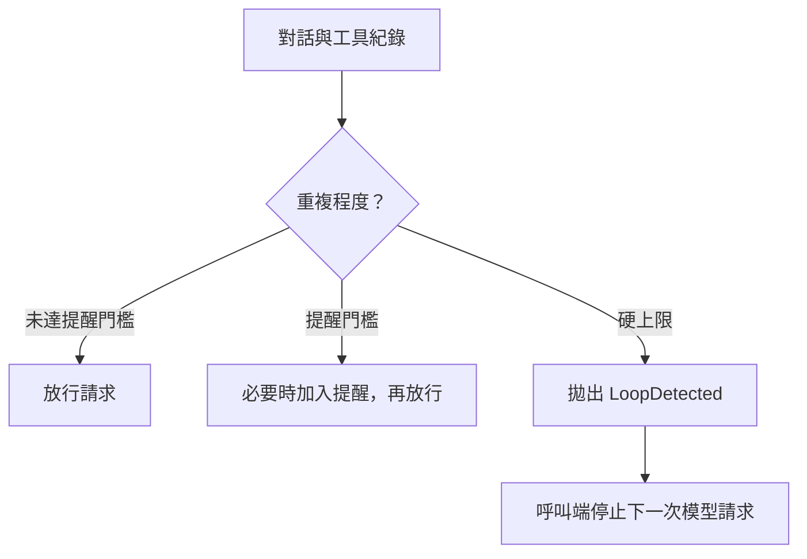

# Proxy Loop Guard

**AI 一直重做同一件事？先提醒換方法，繼續卡住就擋下下一次模型請求。**

[English](README.md) · [繁體中文](README.zh-TW.md) · [MIT 授權](LICENSE)

這個小工具從實際使用的模型轉接程式中獨立出來。它讀取原本就有的工具
呼叫紀錄，判斷 AI 是否原地打轉，不需要再問另一個 AI，也不會連網或回傳資料。
目前沒有量測這個獨立版本能省多少費用，因此不宣稱省三成。

它是給開發者接進程式的 Python 套件，**不是安裝後自動生效的 Claude Code
外掛**，也不是完整的模型轉接服務。資料須使用 OpenAI 風格的對話／工具格式；
其他格式要先轉換。

## 運作方式



擋下須由呼叫端接住例外並停止轉送，不會中止已在執行的工具。

## 一分鐘試跑

需要 Python 3.10 以上：

```sh
git clone https://github.com/u6vu06Ou/proxy-loop-guard.git
cd proxy-loop-guard
python -m pip install .
python -m examples.demo
```

範例故意重複讀取同一個檔案：第 1～3 次放行，第 4～5 次提醒，第 6 次擋下。
因為每輪都沒有新做法，跨輪停滯規則會比單純重複 12 次的上限更早觸發。
整段離線執行，不會花模型費用。目前未發布到 PyPI。

## 接進自己的程式

```python
from proxy_loop_guard import LoopDetected, LoopGuard

guard = LoopGuard()  # 放在請求處理函式外，持續保留狀態。

def handle_model_request(request, conversation_id, call_upstream):
    try:
        guard.check(request, session_id=conversation_id)
    except LoopDetected as error:
        # 轉成你使用的網站框架所需的錯誤回應，這次不要再呼叫模型。
        return {"error": error.detail, "status": error.status_code}
    return call_upstream(request)
```

每次送出模型請求前，把完整的對話與工具結果交給它。同一段對話的
`session_id` 必須固定，不同對話必須不同。第一則非空白的使用者任務也要保留；
它的前 1,200 字與模型名稱會一起參與對話識別。

它會直接修改傳入資料，必要時加上一則提醒。超過硬上限則拋出
`LoopDetected` 例外（通知呼叫端這次應停止）。呼叫端須接住並停止轉送。
例外提供 `status_code=400` 與 `detail`；上面回傳的字典仍須由你的網站框架
轉成真正的 HTTP 錯誤回應。

非同步程式也能使用：檢查本身不連網，通過後才送出模型請求。它不檢查
模型正在傳回的逐字輸出，也不會中止正在執行的工具。

## 抓哪些循環

| 現象 | 提醒 | 擋下 |
| --- | ---: | ---: |
| 同工具、同參數重複 | 5 次 | 12 次 |
| 換參數卻一直得到相同或空結果 | 5 次 | 12 次 |
| 重複抓同網址／搜尋同查詢 | 3 次 | 9 次 |
| 同檔案、同條件重複搜尋 | 5 次 | 15 次 |
| 同命令、同失敗結果 | 5 次 | 12 次 |
| 重跑同一個成功命令 | 25 次 | 50 次 |
| 多輪工具紀錄增加，卻沒有新做法 | 3 輪 | 5 輪 |

同時符合幾條規則時，先到門檻的先生效。例如搜尋工具的參數完全相同，
通常先碰到通用規則的 12 次上限，不會等到搜尋專用規則的 15 次。
命令執行工具需在結果中提供可辨識的結束代碼；缺少代碼時不走命令次數規則。

只檢查最近 160 次工具呼叫；兩次相同行動中間隔了夠多其他呼叫，會重新計數。
同一個訊號的次數沒增加，就不重複塞提醒。

## 怎麼減少誤擋

搜尋同一檔案但使用不同條件，不會被搜尋專用規則當成同一個循環。
修改檔案、寫檔或更新計畫時，正常的「已完成」回覆即使相同，也不當成沒有進展；
不過參數完全相同的重做，仍受通用規則限制。
任務跑得久，本身不是擋下的理由。

專用規則辨識 `Grep`、`Bash`、`WebFetch`、`WebSearch` 等工具名稱。
其他名稱仍有通用檢查，但不會自動理解各框架的特殊意思。完整名稱與行為見
[英文說明](README.md#avoiding-false-alarms)。

## 調整門檻

```python
guard = LoopGuard({"generic_warn": 6, "generic_kill": 16})
diagnostics = guard.snapshot()  # 取得最近一次檢查的獨立副本。
guard.reset()                  # 清掉這個實例記住的全部對話。
```

完整設定在 `DEFAULT_CONFIG`。只調高一條規則，不會停用其他重疊規則。
每個實例各自保存狀態，公開操作有鎖保護。多個程序之間不共用狀態；要保留
跨請求的停滯判斷與提醒去重，須讓同一對話送到同一個程序。

對話紀錄超過 50 筆時才清掉閒置六小時的項目；這不是嚴格的記憶體上限。
套件不建立紀錄檔，但主程式若啟用 Python 日誌，可能記下網址、命令或路徑。
診斷內容也可能包含結果片段，不適合直接放到公開查詢頁。

## 限制

這是用規則猜測是否卡住，不保證每次都猜對。正常輪詢或重讀也可能被擋，
持續換參數與結果的循環則可能漏掉。保留的工具紀錄滿了之後，跨輪停滯判斷
可能無法繼續累積；紀錄範圍內有修改／計畫工具，也會抑制這個訊號。

擋下只代表呼叫端應停止**下一次**模型請求，不會關閉整個工作程序、撤回修改，
或停止已經在執行的工具。工具內部自己的循環，也看不到。

## 測試與來源

```sh
python -m unittest discover -s tests -v
```

包含 15 項離線測試，其中一項會跑原偵測器抽出的整組回歸情境，確認舊問題
沒有再出現。另有 GitHub 自動測試，涵蓋 Linux、Windows 與三個 Python 版本。

從作者私有程式抽出後，加入各實例獨立狀態、英文提醒與不綁網站框架的例外。
沒有帶入轉接路由、金鑰、對話紀錄或原本的 Git 歷史。與 TokenEconomizer 沒有依賴關係。
